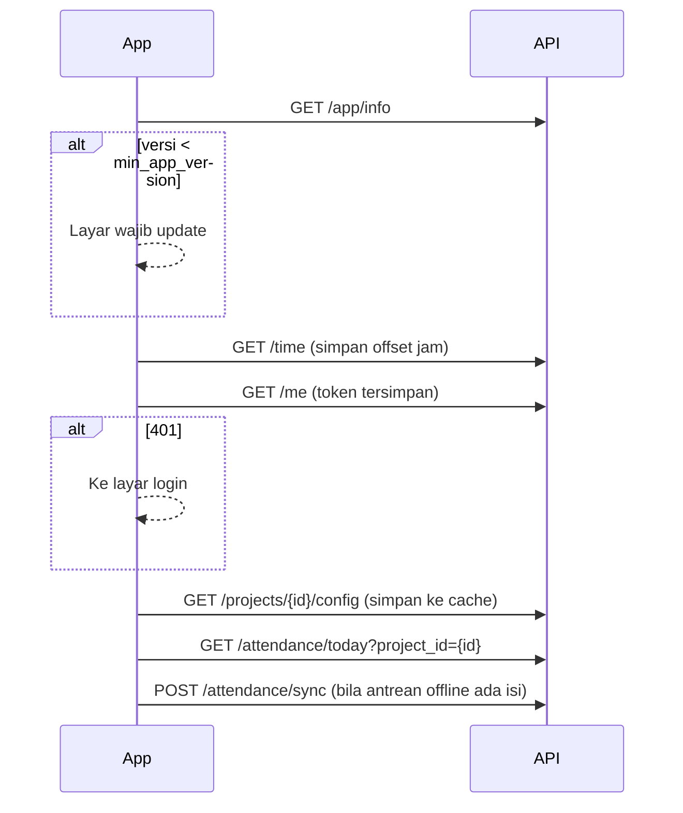

# Dokumentasi API Mobile — Presensi Proyek

**Versi API:** v1 · **Terakhir diperbarui:** 2 Oktober 2026
**Untuk:** tim pengembang aplikasi mobile (Flutter, Android & iOS)

Semua contoh respons di dokumen ini direkam langsung dari server pengembangan, bukan ditulis tangan. Koleksi Postman siap pakai ada di [`Presensi_Proyek_API.postman_collection.json`](Presensi_Proyek_API.postman_collection.json).

---

## Daftar isi

1. [Ringkasan](#1-ringkasan)
2. [Konvensi umum](#2-konvensi-umum)
3. [Kode `reason` (penolakan & error)](#3-kode-reason)
4. [Objek data](#4-objek-data)
5. [Endpoint](#5-endpoint)
   - [Publik](#51-publik): `GET /time` · `GET /app/info` · `POST /auth/login`
   - [Akun](#52-akun): `POST /auth/logout` · `GET /me` · `POST /me/password`
   - [Proyek](#53-proyek): `GET /projects/{id}/config` · `GET /projects/{id}/periods`
   - [Presensi](#54-presensi): `GET /attendance/today` · `POST /attendance/check-in` · `POST /attendance/check-out` · `POST /attendance/sync` · `GET /attendance/history` · `GET /attendance/{id}` · `GET /attendance/{id}/photo/{side}`
   - [Izin / sakit / cuti](#55-izin--sakit--cuti): `GET /leave-requests` · `POST /leave-requests`
   - [Team Leader](#56-team-leader): `GET /team/today` · `GET /approvals` · `PATCH /approvals/leave/{id}` · `PATCH /approvals/offsite/{id}`
6. [Alur yang wajib diikuti aplikasi](#6-alur-yang-wajib-diikuti-aplikasi)
7. [Checklist implementasi](#7-checklist-implementasi)
8. [Akun login per peran](#8-akun-login-per-peran)
9. [Migrasi & data awal (seeder)](#9-migrasi--data-awal-seeder)

---

## 1. Ringkasan

| Item | Nilai |
|---|---|
| Base URL | `https://<domain-server>/api/v1` (lokal: `http://127.0.0.1:8000/api/v1`) |
| Format | JSON, kecuali endpoint unggah foto (`multipart/form-data`) |
| Autentikasi | Bearer token (Laravel Sanctum), didapat dari `POST /auth/login` |
| Zona waktu | Waktu dikirim sebagai ISO 8601 **dengan offset**, mengikuti zona waktu proyek (mis. `+07:00` untuk WIB) |
| Bahasa pesan | Bahasa Indonesia, siap ditampilkan langsung ke pengguna |
| Satu server | = satu perusahaan/KSO, bisa banyak proyek. Setiap klien punya server & build aplikasi sendiri (white-label) |

**Peran pengguna di aplikasi mobile**

| Peran | Akses |
|---|---|
| Karyawan | Presensi, riwayat, pengajuan izin/sakit/cuti, profil |
| Team Leader | Semua akses karyawan + kehadiran tim + persetujuan, **hanya untuk proyek tempat ia menjadi TL** (`is_team_leader: true`) |

Akun super admin / admin proyek tanpa data karyawan **tidak bisa** login ke aplikasi mobile.

---

## 2. Konvensi umum

### 2.1 Header

| Header | Nilai | Keterangan |
|---|---|---|
| `Accept` | `application/json` | **Wajib di semua request**, agar error selalu berupa JSON |
| `Authorization` | `Bearer <token>` | Semua endpoint kecuali yang bertanda *publik* |
| `Content-Type` | `application/json` atau `multipart/form-data` | Sesuai endpoint |

### 2.2 Amplop respons

Semua respons JSON memakai bentuk yang sama:

```json
{
  "success": true,
  "message": "Check-in berhasil.",
  "reason": null,
  "data": { },
  "errors": null
}
```

| Field | Tipe | Keterangan |
|---|---|---|
| `success` | bool | `true` bila berhasil |
| `message` | string \| null | Pesan untuk ditampilkan ke pengguna (boleh `null` pada respons sukses) |
| `reason` | string \| null | **Kode mesin** untuk percabangan logika di aplikasi. `null` bila sukses. Lihat [§3](#3-kode-reason) |
| `data` | object \| array \| null | Isi respons. Pada sebagian error berisi konteks tambahan (mis. jarak ke lokasi) |
| `errors` | object \| null | Hanya untuk `reason: "validation"`: `{ "nama_field": ["pesan", ...] }` |

> **Aturan:** percabangan logika di aplikasi **memakai `reason`**, bukan teks `message` (teks bisa berubah).

### 2.3 Tipe data

| Jenis | Format | Contoh |
|---|---|---|
| Tanggal | `YYYY-MM-DD` | `"2026-10-02"` |
| Waktu lengkap | ISO 8601 + offset zona proyek | `"2026-10-02T08:03:00+07:00"` |
| Jam shift | `HH:mm:ss` | `"08:00:00"` |
| Koordinat | number (derajat desimal) | `-7.3154` |
| Durasi | integer menit + label siap tampil | `568`, `"9 jam 28 menit"` |
| Boolean di multipart | string `"true"` / `"false"` (atau `"1"`/`"0"`) | `is_mock=false` |
| Objek di multipart | string JSON | `device={"model":"Samsung A15","os":"Android 14"}` |

### 2.4 Batas laju (rate limit)

| Endpoint | Batas |
|---|---|
| `POST /auth/login` | 10 request/menit per kombinasi username + IP |
| `POST /attendance/check-in`, `check-out`, `sync` | 30 request/menit per pengguna |

Melebihi batas → HTTP `429`, `reason: "http_429"`. Tampilkan pesan dan coba lagi setelah jeda.

### 2.5 Status HTTP

| Kode | Arti |
|---|---|
| 200 | Berhasil |
| 201 | Data baru dibuat (check-in pertama, pengajuan izin) |
| 401 | Token tidak ada / kedaluwarsa / sudah logout → arahkan ke layar login |
| 403 | Ditolak karena hak akses atau kebijakan (lokasi palsu, perangkat lain, bukan TL) |
| 404 | Data tidak ditemukan |
| 409 | Konflik status (sudah check-in, belum check-in, shift kemarin masih terbuka, sudah diproses) |
| 422 | Validasi / aturan bisnis tidak terpenuhi (di luar radius, akurasi GPS, data offline kedaluwarsa) |
| 429 | Terlalu banyak request |
| 500 | Kesalahan server — tampilkan pesan umum, simpan data offline bila presensi |

---

## 3. Kode `reason`

| `reason` | HTTP | Endpoint | Arti & tindakan aplikasi |
|---|---|---|---|
| `validation` | 422 | semua | Isian tidak valid. Tampilkan `errors` per field |
| `unauthenticated` | 401 | semua (terproteksi) | Token tidak valid → hapus token, ke layar login |
| `invalid_credentials` | 401 | login | Username / password salah |
| `inactive` | 403 | login & semua | Akun dinonaktifkan admin → logout paksa |
| `device_mismatch` | 403 | login | Akun terikat ke HP lain. Minta karyawan menghubungi admin untuk **reset perangkat** |
| `not_assigned` | 403 | presensi | Karyawan tidak terdaftar aktif di proyek pada tanggal tsb |
| `mock_location` | 403 | presensi | Lokasi palsu (Fake GPS) terdeteksi. **Jangan simpan ke antrean offline** |
| `outside_radius` | 422 | presensi | Di luar radius & presensi luar lokasi tidak diizinkan. `data: { distance_m, radius_m }` |
| `low_accuracy` | 422 | presensi (online) | Akurasi GPS > batas. `data: { accuracy, max }`. Minta pindah ke area terbuka lalu ulangi |
| `note_required` | 422 | presensi | Presensi luar lokasi wajib mengisi `note` |
| `checkin_not_open` / `checkin_closed` | 422 | check-in (online) | Di luar jendela check-in shift |
| `no_project_location` | 422 | presensi | Proyek belum punya titik lokasi aktif (masalah konfigurasi admin) |
| `already_checked_in` | 409 | check-in | Sudah check-in untuk tanggal kerja ini → muat ulang `/attendance/today` |
| `open_previous_shift` | 409 | check-in | Shift hari sebelumnya belum check-out. `data: { id, work_date, check_in_time }`. Lihat [§6.4](#64-shift-melewati-tengah-malam) |
| `no_checkin` | 409 | check-out | Tidak ada check-in terbuka dalam batas jam kerja |
| `already_checked_out` | 409 | check-out | Presensi terakhir sudah check-out |
| `offline_not_allowed` | 422 | presensi offline | Proyek tidak mengizinkan presensi offline |
| `offline_expired` | 422 | presensi offline | Data offline lebih tua dari `offline_max_hours` — **permanen**, hapus dari antrean dan beri tahu pengguna |
| `invalid_time` | 422 | presensi offline | `captured_at` kosong atau di masa depan — **permanen** |
| `overlap` | 422 | pengajuan izin | Sudah ada pengajuan pending/disetujui di rentang tanggal tsb |
| `already_processed` | 409 | approval | Pengajuan sudah disetujui/ditolak sebelumnya |
| `forbidden` | — | sync (per item) | Item ditujukan ke proyek yang bukan milik karyawan |
| `http_403` / `http_404` / `http_429` / `http_<kode>` | sesuai | semua | Error HTTP umum (mis. bukan TL proyek, data tidak ditemukan) |

---

## 4. Objek data

### 4.1 `Profile`

Dikembalikan oleh `POST /auth/login` (dalam `data.profile`) dan `GET /me`.

```json
{
  "user": { "id": 9, "username": "agus.irawan", "email": null, "roles": ["employee"] },
  "employee": {
    "id": 8, "nik": null, "name": "Agus Irawan", "full_name": "Agus Irawan",
    "position": "Juru Ukur 1", "phone": null
  },
  "projects": [
    { "id": 1, "code": "KDR", "name": "Nindya - ITP KSO Kedurus", "is_team_leader": false }
  ]
}
```

| Field | Keterangan |
|---|---|
| `employee.name` | Nama dengan gelar (mis. `"Edi Santoso, S.T., M.T."`) — untuk tampilan |
| `projects[]` | Proyek dengan penugasan **aktif hari ini**. Bila lebih dari satu, tampilkan pemilih proyek. Bila kosong, tampilkan pesan "Belum ditugaskan ke proyek" |
| `projects[].is_team_leader` | `true` → tampilkan menu Team Leader untuk proyek tsb |
| `user.roles` | Informasi saja; gunakan `is_team_leader` per proyek untuk menu |

### 4.2 `Attendance`

Dipakai oleh endpoint presensi, riwayat, dan tim.

```json
{
  "id": 273,
  "project_id": 1,
  "employee": { "id": 8, "name": "Agus Irawan", "position": "Juru Ukur 1" },
  "work_date": "2026-10-02",
  "shift": "Jam Kerja Standard",
  "status": "hadir",
  "late_minutes": 0,
  "duration_minutes": 568,
  "duration_label": "9 jam 28 menit",
  "is_holiday_work": false,
  "offsite_approval": "none",
  "flags": [],
  "check_in": {
    "uuid": "1625cd7d-7141-4de8-8feb-9614116ffb62",
    "time": "2026-10-02T08:03:00+07:00",
    "next_day": false,
    "latitude": -7.31545, "longitude": 112.68552, "accuracy": 8.5, "distance_m": 6,
    "mode": "onsite", "note": null, "offline": false,
    "photo_url": "http://127.0.0.1:8765/api/v1/attendance/273/photo/in",
    "thumb_url": "http://127.0.0.1:8765/api/v1/attendance/273/photo/in?thumb=1"
  },
  "check_out": null
}
```

| Field | Tipe | Keterangan |
|---|---|---|
| `work_date` | date | **Tanggal kerja** = tanggal check-in. Check-out lewat tengah malam tetap milik tanggal ini |
| `employee` | object | Hanya ada di `GET /attendance/{id}` dan `GET /approvals` |
| `status` | enum | `hadir` · `terlambat` · `izin` · `sakit` · `cuti` · `alpha` · `libur` |
| `late_minutes` | int | Menit terlambat (0 bila tidak terlambat / fitur terlambat nonaktif) |
| `duration_minutes` / `duration_label` | int / string \| null | Terisi setelah check-out |
| `is_holiday_work` | bool | Masuk pada hari libur / bukan hari kerja |
| `offsite_approval` | enum | `none` (tidak perlu / hanya ditandai) · `pending` · `approved` · `rejected` |
| `flags` | string[] | `missing_checkout` (lupa check-out) · `time_suspicious` (jam offline meragukan) · `low_accuracy` (GPS kurang akurat, data offline) |
| `check_in` / `check_out` | object \| null | `null` bila belum dilakukan (mis. status `alpha`, `izin`) |
| `*.next_day` | bool | `true` bila terjadi di hari setelah `work_date` → tampilkan "01:00 **(+1)**" |
| `*.mode` | enum | `onsite` (dalam radius) · `offsite` (luar lokasi) |
| `*.distance_m` | int | Jarak ke titik lokasi proyek terdekat (meter) |
| `*.offline` | bool | Dikirim lewat sinkron offline |
| `*.uuid` | string \| null | UUID dari aplikasi; `null` untuk data hasil impor/koreksi admin |
| `*.photo_url` / `thumb_url` | url | **Butuh header Authorization** (lihat [§5.4.7](#547-get-attendanceidphotoside)) |

### 4.3 `LeaveRequest`

```json
{
  "id": 2, "project_id": 1, "employee": "Agus Irawan", "type": "sakit",
  "start_date": "2026-10-05", "end_date": "2026-10-06",
  "reason": "Demam, surat dokter menyusul", "has_attachment": false,
  "status": "pending", "approval_note": null, "approved_at": null,
  "created_at": "2026-10-02T17:55:42+07:00"
}
```

`type`: `izin` · `sakit` · `cuti` — `status`: `pending` · `approved` · `rejected`.
Saat disetujui, server otomatis mengisi presensi hari-hari tsb dengan status sesuai jenis (kecuali hari yang sudah ada check-in).

---

## 5. Endpoint

Penulisan: 🔓 = publik (tanpa token), 🔒 = butuh token, 👑 = khusus Team Leader proyek terkait.

### 5.1 Publik

#### 5.1.1 `GET /time` 🔓

Jam server untuk sinkronisasi jam terpercaya (lihat [§6.3](#63-mode-offline--jam-terpercaya)).

```json
{
  "success": true, "message": null, "reason": null,
  "data": { "server_time": "2026-10-02T17:50:56+07:00", "timestamp_ms": 1790938256259 },
  "errors": null
}
```

`timestamp_ms` = epoch milidetik (UTC) — gunakan ini untuk menghitung selisih jam.

#### 5.1.2 `GET /app/info` 🔓

Branding & versi minimum aplikasi. Panggil saat aplikasi dibuka.

```json
{
  "success": true, "message": null, "reason": null,
  "data": {
    "app_name": "Presensi Proyek",
    "company_name": "Nindya - ITP KSO",
    "primary_color": "#1E5AA8",
    "min_app_version": "1.0.0"
  },
  "errors": null
}
```

Bila versi aplikasi < `min_app_version` → tampilkan layar **wajib update** (blokir penggunaan).

#### 5.1.3 `POST /auth/login` 🔓

`Content-Type: application/json`

| Field | Wajib | Tipe | Keterangan |
|---|---|---|---|
| `username` | ✔ | string | |
| `password` | ✔ | string | |
| `device_id` | ✔ | string ≤ 191 | ID unik & **stabil** per instalasi (simpan UUID di secure storage saat pertama kali dibuka; jangan pakai IMEI) |
| `platform` | | `android` \| `ios` | |
| `model` | | string | mis. `"Samsung Galaxy A15"` |
| `os_version` | | string | mis. `"Android 14"` |
| `app_version` | | string | mis. `"1.0.0"` |

```json
{
  "username": "agus.irawan",
  "password": "Presensi#2026",
  "device_id": "qa-device-agus-01",
  "platform": "android",
  "model": "Samsung Galaxy A15",
  "os_version": "Android 14",
  "app_version": "1.0.0"
}
```

**200 OK**

```json
{
  "success": true,
  "message": "Login berhasil.",
  "reason": null,
  "data": {
    "token": "12|Xy...",
    "token_type": "Bearer",
    "profile": { "user": { }, "employee": { }, "projects": [ ] }
  },
  "errors": null
}
```

`profile` = objek [`Profile`](#41-profile). Simpan `token` di **secure storage** (Keychain / Keystore).

**Error:** `invalid_credentials` (401) · `inactive` (403) · `device_mismatch` (403) · `validation` (422) · `http_429`.

```json
{
  "success": false,
  "message": "Akun ini sudah terdaftar di perangkat lain. Hubungi admin untuk reset perangkat.",
  "reason": "device_mismatch", "data": null, "errors": null
}
```

Catatan: login ulang dari HP yang sama diperbolehkan dan **mencabut token lama** perangkat tsb.

### 5.2 Akun

#### 5.2.1 `POST /auth/logout` 🔒

Mencabut token saat ini. Respons: `{ "success": true, "message": "Logout berhasil.", ... }`.
Perangkat tetap terikat ke akun (karyawan bisa login lagi di HP yang sama).

#### 5.2.2 `GET /me` 🔒

Mengembalikan [`Profile`](#41-profile). Panggil saat aplikasi dibuka untuk menyegarkan daftar proyek.

#### 5.2.3 `POST /me/password` 🔒

| Field | Wajib | Keterangan |
|---|---|---|
| `current_password` | ✔ | |
| `password` | ✔ | minimal 8 karakter |
| `password_confirmation` | ✔ | sama dengan `password` |

Error salah password lama:

```json
{
  "success": false, "message": "Password saat ini salah.", "reason": "validation", "data": null,
  "errors": { "current_password": ["Password saat ini salah."] }
}
```

### 5.3 Proyek

#### 5.3.1 `GET /projects/{id}/config` 🔒

Konfigurasi proyek untuk validasi di aplikasi. **Simpan (cache) di HP** agar validasi radius tetap berjalan saat offline. Segarkan saat aplikasi dibuka & setiap kali online.

```json
{
  "success": true, "message": null, "reason": null,
  "data": {
    "project": { "id": 1, "code": "KDR", "name": "Nindya - ITP KSO Kedurus", "timezone": "Asia/Jakarta" },
    "locations": [
      { "id": 1, "name": "Kantor Proyek Kedurus", "latitude": -7.3154, "longitude": 112.6855, "radius_m": 100 }
    ],
    "shift": {
      "id": 1, "name": "Jam Kerja Standard", "start_time": "08:00:00", "end_time": "17:00:00",
      "late_enabled": false, "late_tolerance_min": 0, "checkin_open_time": null, "checkin_close_time": null
    },
    "rules": {
      "offsite_allowed": false,
      "offsite_requires_note": true,
      "offsite_requires_approval": false,
      "max_gps_accuracy_m": 50,
      "block_mock_location": true,
      "require_checkout_in_location": true,
      "max_work_hours": 20,
      "allow_offline": true,
      "offline_max_hours": 72,
      "working_days": [1, 2, 3, 4, 5, 6, 7]
    },
    "holidays": [],
    "is_team_leader": false,
    "fetched_at": "2026-10-02T17:51:00+07:00"
  },
  "errors": null
}
```

| Field | Pemakaian di aplikasi |
|---|---|
| `locations[]` | Hitung jarak (haversine, R = 6.371.000 m) ke setiap titik; ambil terdekat. Di dalam `radius_m` → mode Dalam Lokasi |
| `rules.offsite_allowed` | Bila `false` dan di luar radius → tombol presensi dinonaktifkan, tampilkan jarak. Bila `true` → izinkan dengan label **Luar Lokasi** |
| `rules.offsite_requires_note` | Wajib isi keterangan saat Luar Lokasi |
| `rules.offsite_requires_approval` | Informasikan: "presensi luar lokasi menunggu persetujuan TL" |
| `rules.max_gps_accuracy_m` | Tunggu sampai akurasi GPS ≤ nilai ini sebelum mengizinkan presensi |
| `rules.block_mock_location` | Bila `true` dan lokasi palsu terdeteksi → blokir |
| `rules.require_checkout_in_location` | Bila `false`, check-out tidak perlu validasi radius |
| `rules.max_work_hours` | Batas jendela check-out sejak check-in ([§6.4](#64-shift-melewati-tengah-malam)) |
| `rules.allow_offline` / `offline_max_hours` | Boleh menyimpan presensi saat offline & batas umurnya |
| `rules.working_days` | 1 = Senin … 7 = Minggu (ISO-8601) |
| `holidays[]` | `{ date, name }` — hanya terisi bila proyek memakai libur nasional |
| `shift.checkin_open_time` / `checkin_close_time` | Jendela check-in (null = kapan saja) |

Error: `http_403` bila karyawan tidak terdaftar di proyek.

#### 5.3.2 `GET /projects/{id}/periods` 🔒

Daftar periode laporan ("Bulan ke-N") dari terbaru, untuk filter riwayat.

```json
{
  "success": true, "message": null, "reason": null,
  "data": [
    { "index": 8, "label": "Bulan ke-8", "start": "2026-09-25", "end": "2026-10-26", "is_current": true },
    { "index": 7, "label": "Bulan ke-7", "start": "2026-08-25", "end": "2026-09-26", "is_current": false }
  ],
  "errors": null
}
```

Periode berurutan bisa **tumpang tindih** (mis. 25–26 muncul di dua periode) — ini disengaja mengikuti format laporan proyek.

### 5.4 Presensi

#### 5.4.1 `GET /attendance/today?project_id={id}` 🔒

Status presensi hari ini — **sumber kebenaran tombol di beranda**.

```json
{
  "success": true, "message": null, "reason": null,
  "data": {
    "server_time": "2026-10-02T17:51:06+07:00",
    "work_date": "2026-10-02",
    "is_working_day": true,
    "holiday": null,
    "attendance": { "...": "objek Attendance hari ini atau null" },
    "open_attendance": null
  },
  "errors": null
}
```

| Field | Keterangan |
|---|---|
| `attendance` | [`Attendance`](#42-attendance) untuk `work_date` hari ini, atau `null` |
| `open_attendance` | [`Attendance`](#42-attendance) dari **hari sebelumnya** yang belum check-out dan masih dalam `max_work_hours`, atau `null` |
| `is_working_day` / `holiday` | Informasi hari kerja & nama hari libur |

**Logika tombol beranda:**

| Kondisi | Tampilkan |
|---|---|
| `open_attendance != null` | Tombol **Check-out** untuk shift `open_attendance.work_date` (mis. "Check-out shift 2 Okt") |
| `attendance == null` | Tombol **Check-in** |
| `attendance.check_in != null` & `check_out == null` | Tombol **Check-out** |
| `attendance.check_out != null` | Ringkasan hari ini (selesai) |
| `attendance.status` ∈ izin/sakit/cuti | Info "Anda sedang izin/sakit/cuti" (check-in tetap boleh) |

#### 5.4.2 `POST /attendance/check-in` 🔒

`Content-Type: multipart/form-data`

| Field | Wajib | Tipe | Keterangan |
|---|---|---|---|
| `uuid` | ✔ | UUID v4 | **Dibuat aplikasi** per aksi presensi. Kirim ulang dengan uuid sama = aman (tidak dobel) |
| `project_id` | ✔ | int | |
| `latitude` | ✔ | number −90..90 | |
| `longitude` | ✔ | number −180..180 | |
| `accuracy` | | number ≥ 0 | Akurasi GPS (meter) |
| `is_mock` | | bool | Hasil deteksi lokasi palsu (Android: `Position.isMocked`) |
| `note` | | string ≤ 255 | Wajib bila Luar Lokasi & `offsite_requires_note` |
| `photo` | ✔ | jpg/jpeg/png ≤ 5 MB | Selfie kamera depan (kompres ±300 KB, lebar ±1080 px) |
| `device` | | JSON string | `{"model","os","app_version"}` |
| `is_offline` | | bool | `true` hanya untuk data dari antrean offline |
| `captured_at` | jika offline | ISO 8601 | Waktu terpercaya saat presensi diambil ([§6.3](#63-mode-offline--jam-terpercaya)) |
| `device_time` | | ISO 8601 | Jam HP saat itu (audit) |
| `flags` | | JSON string array | mis. `["time_suspicious"]` bila HP reboot sejak sinkron jam terakhir |
| `abandon_previous` | | bool | `true` = shift kemarin ditandai lupa check-out lalu presensi baru dibuat ([§6.4](#64-shift-melewati-tengah-malam)) |

Contoh (cURL):

```bash
curl -X POST "$BASE/attendance/check-in" \
  -H "Accept: application/json" -H "Authorization: Bearer $TOKEN" \
  -F uuid=5b8073b4-41da-4fe7-8e22-1cfc1726844d -F project_id=1 \
  -F latitude=-7.31545 -F longitude=112.68552 -F accuracy=8.5 -F is_mock=false \
  -F 'device={"model":"Samsung Galaxy A15","os":"Android 14","app_version":"1.0.0"}' \
  -F photo=@selfie.jpg
```

**201 Created** (atau **200** bila uuid yang sama dikirim ulang):

```json
{
  "success": true,
  "message": "Check-in berhasil.",
  "reason": null,
  "data": { "id": 277, "work_date": "2026-10-02", "status": "hadir", "...": "objek Attendance lengkap" },
  "errors": null
}
```

Bila Luar Lokasi, `message` menjadi `"Check-in berhasil. (Luar Lokasi)"` dan `check_in.mode = "offsite"`.

**Contoh error:**

```json
{
  "success": false,
  "message": "Anda berada 500 m dari Kantor Proyek Kedurus (radius 100 m).",
  "reason": "outside_radius",
  "data": { "distance_m": 500, "radius_m": 100 },
  "errors": null
}
```

```json
{
  "success": false,
  "message": "Akurasi GPS terlalu rendah (120 m). Pindah ke area terbuka dan coba lagi.",
  "reason": "low_accuracy",
  "data": { "accuracy": 120, "max": 50 },
  "errors": null
}
```

```json
{
  "success": false, "message": "UUID harus berupa UUID yang valid.", "reason": "validation", "data": null,
  "errors": {
    "uuid": ["UUID harus berupa UUID yang valid."],
    "latitude": ["Latitude wajib diisi."],
    "longitude": ["Longitude wajib diisi."],
    "photo": ["Foto wajib diisi."]
  }
}
```

Error lain: `mock_location`, `not_assigned`, `note_required`, `checkin_not_open`, `checkin_closed`, `already_checked_in`, `open_previous_shift`, `offline_not_allowed`, `offline_expired`, `invalid_time`.

#### 5.4.3 `POST /attendance/check-out` 🔒

Field **sama dengan check-in** (kecuali `abandon_previous` tidak dipakai). Server otomatis menutup check-in terbuka terbaru dalam `max_work_hours` — termasuk shift kemarin bila check-out dilakukan lewat tengah malam.

**200 OK** — objek [`Attendance`](#42-attendance) dengan `check_out`, `duration_minutes`, `duration_label` terisi.

Error: `no_checkin`, `already_checked_out`, `outside_radius` (bila `require_checkout_in_location`), `mock_location`, `low_accuracy`, `offline_*`, `invalid_time`.

#### 5.4.4 `POST /attendance/sync` 🔒

Kirim antrean presensi offline secara **batch berurutan** (maks. 20 item per request).

`Content-Type: multipart/form-data` — setiap item memakai prefiks `items[i][...]`:

| Field | Keterangan |
|---|---|
| `items[i][type]` | `check_in` atau `check_out` (wajib) |
| `items[i][...]` | Semua field check-in/check-out ([§5.4.2](#542-post-attendancecheck-in)), termasuk `photo` |
| `items[i][is_offline]` | Default `true` bila tidak dikirim |
| `items[i][captured_at]` | Wajib untuk item offline |

Contoh field multipart:

```
items[0][type]=check_in
items[0][uuid]=5878480f-d5e0-45a6-ba41-63006b9749fe
items[0][project_id]=1
items[0][latitude]=-7.31545
items[0][longitude]=112.68552
items[0][accuracy]=8.5
items[0][captured_at]=2026-10-01T01:02:00.000Z
items[0][photo]=<file>
items[1][type]=check_out
items[1][uuid]=c54b627a-9acc-41d3-8019-61ebe52c2eed
...
```

**200 OK** — hasil **per item**, urutan sama dengan kiriman:

```json
{
  "success": true, "message": null, "reason": null,
  "data": [
    { "uuid": "5878480f-…", "type": "check_in",  "success": true, "data": { "id": 274, "work_date": "2026-10-01", "...": "Attendance" } },
    { "uuid": "c54b627a-…", "type": "check_out", "success": true, "data": { "id": 274, "work_date": "2026-10-01", "...": "Attendance" } },
    { "uuid": "2702c624-…", "type": "check_in",  "success": false, "reason": "offline_expired",
      "message": "Data offline lebih dari 72 jam, tidak dapat diterima. Hubungi admin." }
  ],
  "errors": null
}
```

Penanganan hasil per item:

| Hasil | Tindakan |
|---|---|
| `success: true` | Hapus dari antrean, simpan `data` ke cache riwayat |
| `reason` ∈ `offline_expired`, `invalid_time`, `outside_radius`, `mock_location`, `not_assigned`, `already_checked_in`, `already_checked_out`, `validation`, `forbidden`, `offline_not_allowed`, `note_required` | **Permanen** — hapus dari antrean, tampilkan di layar "Data tidak terkirim" beserta `message` |
| `no_checkin` pada `check_out` | Bila item `check_in` pasangannya masih di antrean, kirim ulang nanti; bila tidak, perlakukan permanen |
| HTTP 5xx / jaringan putus | Simpan di antrean, coba lagi (backoff) |

Data offline yang tiba terlambat **menimpa** status `alpha` yang sudah dibuat sistem untuk tanggal tsb.

#### 5.4.5 `GET /attendance/history` 🔒

| Query | Wajib | Keterangan |
|---|---|---|
| `project_id` | ✔ | |
| `from`, `to` | | Rentang tanggal (maks. 93 hari). Bila kosong → **periode berjalan** |

```json
{
  "success": true, "message": null, "reason": null,
  "data": {
    "from": "2026-03-20",
    "to": "2026-03-21",
    "summary": { "hadir": 2 },
    "items": [ { "id": 216, "work_date": "2026-03-21", "status": "hadir", "...": "Attendance" } ]
  },
  "errors": null
}
```

`summary` = objek jumlah per status (kunci hanya muncul bila ada; `{}` bila kosong). `items` urut tanggal terbaru dulu. Gunakan `GET /projects/{id}/periods` untuk pilihan "Bulan ke-N".

#### 5.4.6 `GET /attendance/{id}` 🔒

Detail satu presensi ([`Attendance`](#42-attendance) + `employee`). Hanya pemilik atau Team Leader proyek tsb (lainnya `http_403`).

#### 5.4.7 `GET /attendance/{id}/photo/{side}` 🔒

| Parameter | Keterangan |
|---|---|
| `side` | `in` atau `out` |
| `?thumb=1` | Thumbnail ±160 px (untuk daftar) |

Respons berupa **gambar JPEG** (bukan JSON), `Cache-Control: private, max-age=86400`. Karena butuh token, muat dengan header, mis. di Flutter:

```dart
Image.network(attendance.checkIn.thumbUrl, headers: {'Authorization': 'Bearer $token'})
// atau CachedNetworkImage(imageUrl: ..., httpHeaders: {...})
```

Hak akses sama dengan detail presensi. `404` bila foto tidak ada (mis. data impor/manual).

### 5.5 Izin / sakit / cuti

#### 5.5.1 `GET /leave-requests?project_id={id}` 🔒

Daftar pengajuan milik karyawan (maks. 100, terbaru dulu) — array [`LeaveRequest`](#43-leaverequest).

#### 5.5.2 `POST /leave-requests` 🔒

`multipart/form-data` (atau JSON bila tanpa lampiran)

| Field | Wajib | Keterangan |
|---|---|---|
| `project_id` | ✔ | |
| `type` | ✔ | `izin` · `sakit` · `cuti` |
| `start_date` | ✔ | `YYYY-MM-DD` |
| `end_date` | ✔ | ≥ `start_date` |
| `reason` | ✔ | ≤ 1000 karakter |
| `attachment` | | jpg/jpeg/png/pdf ≤ 5 MB (mis. surat dokter) |

**201 Created** — [`LeaveRequest`](#43-leaverequest) dengan `status: "pending"`.
Error: `overlap` (422) bila bertabrakan dengan pengajuan pending/disetujui.

### 5.6 Team Leader

Semua endpoint di bagian ini 👑 — hanya untuk karyawan dengan `is_team_leader: true` di proyek terkait; lainnya `http_403` ("Khusus Team Leader proyek ini.").

#### 5.6.1 `GET /team/today?project_id={id}` 👑

```json
{
  "success": true, "message": null, "reason": null,
  "data": {
    "date": "2026-10-02",
    "summary": { "total": 9, "checked_in": 1, "offsite": 0, "late": 0 },
    "members": [
      { "employee_id": 8, "name": "Agus Irawan", "position": "Juru Ukur 1", "attendance": { "...": "Attendance" } },
      { "employee_id": 4, "name": "Bambang Rianto, S.T.", "position": "Ahli Hidromekanikal", "attendance": null }
    ]
  },
  "errors": null
}
```

`members` urut nama; `attendance: null` = belum presensi.

#### 5.6.2 `GET /approvals` 👑

Semua yang menunggu persetujuan di proyek-proyek tempat pengguna menjadi TL.

```json
{
  "success": true, "message": null, "reason": null,
  "data": {
    "leave_requests": [ { "id": 2, "employee": "Agus Irawan", "type": "sakit", "status": "pending", "...": "LeaveRequest" } ],
    "offsite_attendances": [ ]
  },
  "errors": null
}
```

`offsite_attendances` (objek [`Attendance`](#42-attendance) + `employee`) hanya terisi bila proyek mengaktifkan persetujuan luar lokasi.

#### 5.6.3 `PATCH /approvals/leave/{id}` 👑

```json
{ "action": "approve", "note": "Semoga lekas sembuh" }
```

| Field | Wajib | Keterangan |
|---|---|---|
| `action` | ✔ | `approve` · `reject` |
| `note` | | ≤ 500 karakter |

**200 OK** — [`LeaveRequest`](#43-leaverequest) terbaru (`status: "approved"`, `approval_note`, `approved_at`). Error: `already_processed` (409).

#### 5.6.4 `PATCH /approvals/offsite/{id}` 👑

Body sama dengan 5.6.3, `{id}` = id presensi. **200 OK** — [`Attendance`](#42-attendance) dengan `offsite_approval` = `approved` / `rejected`. Error: `already_processed` (409) bila tidak sedang `pending`.

---

## 6. Alur yang wajib diikuti aplikasi

### 6.1 Saat aplikasi dibuka



### 6.2 Check-in / check-out

1. Pastikan izin lokasi & kamera. Ambil posisi GPS akurasi tinggi; tunggu `accuracy ≤ rules.max_gps_accuracy_m` (beri batas waktu ±20 detik, tampilkan akurasi saat ini).
2. Deteksi lokasi palsu (`is_mock`) dan root/jailbreak; bila `block_mock_location` → blokir.
3. Hitung jarak ke `locations[]`:
   - di dalam radius → **Dalam Lokasi**;
   - di luar radius & `offsite_allowed` → **Luar Lokasi**, minta `note` bila `offsite_requires_note`;
   - di luar radius & tidak diizinkan → nonaktifkan tombol, tampilkan "Anda berada X m dari …".
4. Buka kamera depan (tanpa galeri), kompres foto.
5. Buat `uuid` baru, **simpan dulu ke antrean lokal**, lalu kirim:
   - online → `POST /attendance/check-in|check-out`;
   - gagal jaringan / offline & `allow_offline` → biarkan di antrean dengan `is_offline=true` + `captured_at`.
6. Tangani `reason` sesuai [§3](#3-kode-reason). Setelah sukses, hapus dari antrean dan muat ulang `/attendance/today`.

> Validasi di aplikasi hanya untuk UX. **Server tetap memvalidasi ulang** semua aturan.

### 6.3 Mode offline & jam terpercaya

Jam HP bisa diubah pengguna, sehingga waktu presensi offline dihitung dari **jam server terakhir + jam monotonic** (tidak terpengaruh pengubahan jam HP):

```
Saat online (GET /time):
  serverMs   = data.timestamp_ms
  elapsedMs  = waktu sejak boot (Android: SystemClock.elapsedRealtime; iOS: ProcessInfo.systemUptime)
  bootId     = penanda boot (Android: Settings.Global.BOOT_COUNT; iOS: kernel boottime)
  → simpan { serverMs, elapsedMs, bootId }

Saat presensi offline:
  captured_at = serverMs + (elapsedSekarang − elapsedMs)      → kirim sebagai ISO 8601 UTC
  bila bootId berbeda (HP sempat restart):
      captured_at = jam HP, flags = ["time_suspicious"]
```

Aturan antrean:

- Simpan item (termasuk file foto terkompres) di SQLite lokal, **urut waktu**.
- Kirim saat koneksi kembali, saat aplikasi dibuka, dan dari background task (Android WorkManager; iOS background fetch — tidak dijamin).
- Kirim lewat `POST /attendance/sync` maks. 20 item per request, berurutan (check-in sebelum check-out).
- Data lebih tua dari `offline_max_hours` akan ditolak server (`offline_expired`) — peringatkan pengguna bila ada item yang mendekati batas.
- Tampilkan jumlah data belum terkirim di beranda dan layar daftar antrean.

### 6.4 Shift melewati tengah malam

Presensi milik **tanggal check-in**. Contoh: masuk 2 Okt 08:00, pulang 3 Okt 01:00 → satu presensi `work_date = 2026-10-02`, durasi 17 jam, `check_out.next_day = true`.

| Situasi | Perilaku |
|---|---|
| Lewat tengah malam, belum check-out | `/attendance/today` → `attendance: null`, `open_attendance: {work_date: "2026-10-02"}` → tampilkan **Check-out** |
| Check-out 01:00 | Menutup presensi 2 Okt (selama ≤ `max_work_hours` sejak check-in) |
| Check-in saat shift kemarin masih terbuka | `409 open_previous_shift` + `data: {id, work_date, check_in_time}`. Tampilkan dialog: **"Check-out shift 2 Okt"** (panggil check-out) atau **"Lupa check-out, mulai presensi baru"** (ulangi check-in dengan `abandon_previous=true` — presensi lama ditandai lupa check-out) |
| Check-out setelah `max_work_hours` lewat | `409 no_checkin` → minta hubungi admin untuk koreksi |

### 6.5 Perangkat & sesi

- `device_id` dibuat sekali per instalasi dan disimpan di secure storage. Hapus instal / ganti HP → `device_mismatch` → admin melakukan **Reset perangkat** di web.
- Reset password / reset perangkat / akun dinonaktifkan oleh admin akan **mencabut token** → request berikutnya `401` atau `403 inactive` → kembali ke login.

---

## 7. Checklist implementasi

- [ ] Semua request mengirim `Accept: application/json`
- [ ] Logika berbasis `reason`, bukan teks `message`
- [ ] Token & `device_id` di secure storage
- [ ] Cek `min_app_version` saat dibuka
- [ ] Cache `config` proyek; segarkan saat online
- [ ] Jam terpercaya dari `GET /time` + jam monotonic
- [ ] UUID per aksi presensi; simpan ke antrean sebelum dikirim
- [ ] Sinkron batch + penanganan hasil per item (permanen vs coba lagi)
- [ ] Foto: kamera depan, tanpa galeri, kompres ±300 KB
- [ ] Deteksi lokasi palsu & root/jailbreak
- [ ] Tombol beranda mengikuti `attendance` + `open_attendance`
- [ ] Dialog `open_previous_shift` (check-out vs `abandon_previous`)
- [ ] Penanda `(+1)` bila `next_day = true`
- [ ] Foto dimuat dengan header Authorization
- [ ] Menu Team Leader hanya bila `is_team_leader` di proyek aktif
- [ ] Tangani `401` (login ulang) dan `429` (coba lagi nanti) secara global

Akun uji tiap peran ada di [§8](#8-akun-login-per-peran); cara menyiapkan data awal di [§9](#9-migrasi--data-awal-seeder).

---

## 8. Akun login per peran

Akun di bawah ini dibuat oleh seeder untuk **server pengembangan & QA** (proyek contoh **KDR — Nindya - ITP KSO Kedurus**).

> Jangan jalankan seeder demo di server produksi. Untuk klien sungguhan pakai `php artisan app:install` ([§9.3](#93-server-klien-baru-tanpa-data-demo)) dan ganti semua password.

| Peran | Username | Password | Masuk lewat | Bisa melakukan |
|---|---|---|---|---|
| Super admin | `admin` | `password` | Web admin | Semua proyek, pengguna admin, pengaturan aplikasi (logo, warna) |
| Admin proyek | `admin.kdr` | `password` | Web admin | Kelola proyek KDR saja: karyawan, shift, titik lokasi, libur, pengaturan proyek, monitoring, persetujuan, laporan |
| Team Leader | `edi.santoso` | `Presensi#2026` | Web admin & aplikasi mobile | Web: dashboard, monitoring (lihat saja), persetujuan, laporan. Mobile: presensi pribadi + kehadiran tim & persetujuan |
| Karyawan | lihat tabel di bawah | `Presensi#2026` | Aplikasi mobile saja | Presensi, riwayat, izin/sakit/cuti, ganti password. Login web ditolak |

**Akun karyawan proyek KDR** (semua password `Presensi#2026`):

| Username | Nama | Jabatan |
|---|---|---|
| `edi.santoso` | Edi Santoso, S.T., M.T. | Team Leader |
| `puguh.sarwono` | Puguh Sarwono | Water Resources Engineer |
| `danang.trisno` | Danang Ady Trisno, S.T. | Ahli Hidrologi |
| `bambang.rianto` | Bambang Rianto, S.T. | Ahli Hidromekanikal |
| `edy.jayanto` | Edy Jayanto, S.T. | Ahli Geologi/Geoteknik |
| `helmy.wijaya` | Helmy Mukti Wijaya, S.T. | Ahli Geodesi |
| `nabilah.ismiradiana` | Nabilah Ismiradiana | CAD Operator 1 |
| `agus.irawan` | Agus Irawan | Juru Ukur 1 |
| `budiarto` | Budiarto | Administrasi dan Keuangan |

| Alamat | Lokal |
|---|---|
| Web admin | `http://127.0.0.1:8000/login` |
| API mobile | `http://127.0.0.1:8000/api/v1` |

Catatan untuk pengujian mobile:

- **Satu akun satu perangkat:** login pertama mengikat akun ke `device_id`. Login dari perangkat lain ditolak `device_mismatch` sampai admin menekan **Reset perangkat** (web › Karyawan › menu ⋯).
- Titik lokasi KDR: **−7.3154, 112.6855**, radius 100 m. Dalam radius: `-7.31545, 112.68552`. Di luar radius (±500 m): `-7.3109, 112.6855`.

---

## 9. Migrasi & data awal (seeder)

### 9.1 Prasyarat

| Kebutuhan | Versi |
|---|---|
| PHP | 8.3 atau lebih baru, ekstensi `pdo_mysql`, `gd`, `mbstring`, `fileinfo`, `zip`, `intl` |
| Composer | 2.x |
| MySQL | 8.x (atau MariaDB 10.6+) |
| Node.js | 20+ — hanya di komputer pengembang untuk build aset web (`public/build` ikut di-deploy) |

### 9.2 Server pengembangan / QA (dengan data demo)

Langkah berurutan dari folder `backend`:

1. Buat database kosong, mis. `presensi_proyek` (utf8mb4). Untuk automated test buat juga `presensi_proyek_test`.
2. Pasang dependensi & konfigurasi:

```bash
composer install
cp .env.example .env
php artisan key:generate
```

3. Isi koneksi database di `.env`:

```bash
DB_CONNECTION=mysql
DB_HOST=127.0.0.1
DB_PORT=3306
DB_DATABASE=presensi_proyek
DB_USERNAME=root
DB_PASSWORD=
APP_ENV=local
APP_TIMEZONE=Asia/Jakarta
```

4. Jalankan migrasi sekaligus seeder:

```bash
php artisan migrate --seed
```

5. Build aset web & jalankan server:

```bash
npm install
npm run build
php artisan serve
```

6. Buka `http://127.0.0.1:8000/login` dan masuk dengan akun di [§8](#8-akun-login-per-peran).

**Isi data awal yang dibuat seeder** (urutan eksekusi `DatabaseSeeder`):

| Urutan | Seeder / perintah | Data yang dibuat |
|---|---|---|
| 1 | `RoleSeeder` | Peran `super_admin`, `project_admin`, `team_leader`, `employee` |
| 2 | (di `DatabaseSeeder`) | Akun super admin `admin` |
| 3 | `KedurusProjectSeeder` | Profil aplikasi (Nindya - ITP KSO), proyek **KDR** (kontrak mulai 1 Feb 2026 → Bulan ke-1 = 25 Feb–26 Mar 2026), titik lokasi Kantor Proyek Kedurus (radius 100 m), shift Jam Kerja Standard 08:00–17:00, 9 jabatan & 9 karyawan beserta akunnya, penandatangan laporan "Dibuat" (Edi Santoso), kota laporan Surabaya |
| 4 | `ProjectAdminSeeder` | Akun admin proyek `admin.kdr` untuk proyek KDR |
| 5 | `holidays:import 2026` | 25 libur nasional & cuti bersama 2026 (tidak aktif sampai diaktifkan di pengaturan proyek; **verifikasi dengan SKB resmi**) |
| 6 | `DemoAttendanceSeeder` | 270 presensi Bulan ke-1 dari dokumen `ABSENSI BULAN 1.pdf` (tanpa foto). **Hanya jalan bila `APP_ENV=local`** |

Perintah lain yang sering dipakai:

| Kebutuhan | Perintah |
|---|---|
| Reset total ke data demo (**menghapus semua data**) | `php artisan migrate:fresh --seed` |
| Menjalankan satu seeder saja (aman diulang) | `php artisan db:seed --class=ProjectAdminSeeder` |
| Menambah tabel baru setelah update kode | `php artisan migrate` |
| Melihat status migrasi | `php artisan migrate:status` |
| Menjalankan scheduler & antrean laporan secara lokal | `php artisan schedule:work` |
| Automated test (memakai database `presensi_proyek_test`) | `php artisan test` |

### 9.3 Server klien baru (tanpa data demo)

Untuk server produksi / klien baru, **jangan** memakai `--seed` (data demo dan password bawaan ikut terbuat).

```bash
composer install --no-dev --optimize-autoloader
cp .env.example .env            # APP_ENV=production, APP_DEBUG=false, DB_*, APP_URL
php artisan key:generate
php artisan app:install --company="Nama Perusahaan / KSO" --app-name="Presensi Proyek" \
    --username=admin --email=admin@perusahaan.co.id
php artisan holidays:import 2026
php artisan config:cache && php artisan route:cache && php artisan view:cache
```

`app:install` menjalankan migrasi, membuat peran, menyimpan nama perusahaan & aplikasi, lalu membuat super admin (password ditanyakan secara interaktif, atau lewat `--password=`).

Setelah itu, lewat web admin sebagai super admin:

1. **Daftar Proyek** → buat proyek (kode, nama, kontrak, zona waktu). Shift standar dibuat otomatis.
2. **Titik Lokasi** → tentukan titik & radius di peta.
3. **Shift & Jam Kerja** → sesuaikan jam masuk/pulang dan aturan terlambat.
4. **Karyawan** → tambah karyawan beserta akun login; tandai Team Leader.
5. **Pengaturan Proyek** → periode laporan, hari kerja & libur, lokasi & presensi, offline, laporan, penandatangan.
6. **Pengguna Admin** → buat akun admin proyek bila perlu.

Terakhir, pasang satu cron di server:

```bash
* * * * * php /path/ke/backend/artisan schedule:run >> /dev/null 2>&1
```

Cron ini menjalankan penandaan alpha/libur (00:30), lupa check-out (tiap jam), pembersihan laporan lama (02:00), dan antrean laporan besar. Di VPS dengan Supervisor set `QUEUE_VIA_SCHEDULER=false` dan jalankan `php artisan queue:work` sebagai layanan.
